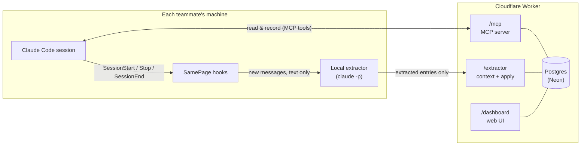

<div align="center">

<picture>
  <source media="(prefers-color-scheme: dark)" srcset="docs/brand/symbol-reverse.svg">
  
</picture>

# SamePage

**Shared team memory for AI agents.**

Your team decides things in meetings, chats and agent sessions.
SamePage makes sure every teammate's agent knows what was decided, by whom, why, and how sure the team was, so nobody has to explain it again.


-336791)


[](LICENSE)

[Why](#why-samepage) · [How it works](#how-it-works) · [Quick start](#quick-start) · [Self-hosting](#self-hosting) · [MCP tools](#mcp-tools) · [Development](#development) · [Roadmap](#roadmap)

</div>

---

## Why SamePage?

A small team makes decisions everywhere: video calls, WhatsApp, a hallway, and more and more often inside conversations with Claude Code, ChatGPT or Gemini. Then each person has to re-teach that context to their own agent. **People become the sync mechanism**, and over time every agent ends up believing something slightly different.

SamePage is a **single source of truth** about the company's decisions, vision and context. Every teammate's agent reads from it and feeds it, in the background.

What sets it apart from generic memory tools:

| | |
|---|---|
| 🗣️ **Keeps the debate, not just the outcome** | Who argued for what, with which arguments, and how strong the consensus was. |
| 👥 **Built for a team, with authorship** | Every entry has authors. A personal opinion is never confused with a team decision. |
| 🛡️ **Decisions can't be overturned silently** | One person contradicting a team decision creates a *proposal* that another teammate has to accept. |
| 🔒 **Conversations never leave your machine** | Capture runs locally; only the extracted entries reach the server. |
| 💸 **Zero cost** | Runs on free tiers (Cloudflare Workers + Neon) and uses the Claude subscriptions the team already pays for. |

It covers the whole company, not just engineering: product, roadmap, marketing, positioning and tone of voice.

## How it works



1. **At session start**, the MCP server sends a short summary (≤ 2,000 characters) with the server instructions: principles, recent decisions, what changed since your last session, open proposals, and questions waiting for you.
2. **While you work**, your agent searches the memory before architecture, product or marketing work. If it is about to suggest something that contradicts a recorded decision, it still makes the suggestion, but shows you the decision, who made it and why, and asks what to do.
3. **When you say so** ("record this: we decided X with Y"), the agent calls `record` directly.
4. **When a session ends** (or goes idle, or after every 15 of your messages in long sessions), a local `claude -p` pass reads the new messages and keeps only what the team would want to know later. The bar is high: most sessions produce nothing.
5. **When the extractor isn't sure** something is about the company, it doesn't guess. It creates a *pending question* that your agent asks you at a natural moment. Your answers are kept as corrections, so the extractor learns.

### The data model

| Type | What it is | Example |
|---|---|---|
| `decision` | The team settled a question. Can include the question, each person's position and arguments, and the degree of consensus. | "Price per seat, not per school (majority; we moved on because…)" |
| `principle` | A stable truth that is always in context. | Product vision, tone of voice |
| `view` | One person's opinion. Has an owner, is not a decision. | "Miguel thinks we should position as X" |
| `exploration` | An idea discussed without a conclusion. | Brainstorms that should not be mistaken for decisions |
| `proposal` | A request to revise a decision. Visible to everyone until accepted or rejected. | |
| `workstream` | A tracked piece of work: `in_progress`, `blocked` or `done`. | |
| `update` | A short progress note on a workstream. | One per captured session |

Decisions are never edited or deleted by evolution: a new decision **supersedes** the old one, and both stay in the history, linked.

### The supersede rule

- A new **team** decision (several authors) replaces the old one directly.
- **One person** contradicting a team decision creates a **proposal** instead.
- A proposal is accepted or rejected by **someone other than the proposer**. On acceptance it becomes the active decision.

## Privacy

Privacy is enforced in layers, and the strongest ones don't depend on a model understanding intent:

1. **Opt-in folders.** Capture only runs in the folders you chose at setup (and their subfolders).
2. **Deterministic controls**, checked by the hook *before* any processing:
   - `/private`: this session is never processed;
   - `/forget`: everything not yet captured is dropped.
3. **Local processing.** The transcript is read on your machine: only your messages and the agent's replies (no tool calls or tool results), with a size cap. Only the extracted entries are sent.
4. **Extractor filter.** Personal matters and routine work steps are excluded by its rules, and doubtful items become questions, not entries.
5. **You own your entries.** Any listed author can fix the text of an entry or delete it. Deletions show up in everyone's "what's new", for transparency.
6. **Daily limit.** Capture stops after `dailyLimit` passes per day (default 20), so it never eats your subscription.

## Quick start

> Joining a team that already runs SamePage? You need **Claude Code** (the desktop app is enough).

1. Open the team link your admin shared (`https://<your-worker>/join/<code>`) and copy the message on the page.
2. Paste it into Claude: the desktop app's Code tab, or a terminal session.
3. Claude asks your name, confirms the company folder, installs Node 22 if it is missing, and runs the setup.
4. A window opens to approve your Claude login, so capture uses **your own** Claude subscription. Approve it there.
5. Open a new session: `/mcp` shows `samepage` connected, and your team summary arrives at the start of every session.

Prefer the terminal? With Node 22+ installed:

```bash
npx -y https://<your-worker>/samepage-setup.tgz --join <code>
```

The setup connects the SamePage MCP server to Claude Code (CLI and desktop app), adds the capture hooks to `~/.claude/settings.json` (the first install keeps a backup) and installs the capture client in `~/.samepage/`. The client then updates itself; there is nothing to re-run.

Setting it up on a second computer? Use the same name and add `--same-person`. Someone else on the team has your name? Pick a distinct one, e.g. `"Ana Silva (Marketing)"`.

To undo everything (hooks, MCP connection, `~/.samepage`):

```bash
npx -y https://<your-worker>/samepage-setup.tgz --uninstall
```

The full client guide (files, logs, configuration) is in [integrations/claude-code/README.md](integrations/claude-code/README.md).

### Talking to it

You don't need to learn any commands. Talk to your agent normally:

- *"What did we decide about pricing?"* → `search_context`
- *"Record this: we decided with Ana to drop the free plan, because…"* → `record`
- *"That entry was personal, delete it."* → `delete_entry`
- *"Open the dashboard."* → `open_dashboard`

## Self-hosting

SamePage runs on **Cloudflare Workers** (code) and **Neon** (Postgres), both on free tiers. A small team's daily use stays far below their limits; the one to watch is the Workers 10 ms CPU limit per request.

**Prerequisites:** Node 22+, a Cloudflare account and a Neon project.

```bash
git clone https://github.com/MiguelR0drigues/samepage.git
cd samepage
npm install
```

**1. Get two connection strings from Neon:** the **pooled** one (host contains `-pooler`) for the Worker, and the **direct** one for migrations and admin scripts.

**2. Apply the schema** (with the direct string):

```bash
DATABASE_URL="<direct string>" npm run db:migrate
```

**3. Create the system person** for non-human authors, such as a meeting-notes routine (teammates join with the team link in step 6):

```bash
DATABASE_URL="<direct string>" npm run person:add -- meet "Meet" --system
```

**4. Set the Worker secrets:**

```bash
npx wrangler login
npx wrangler secret put DATABASE_URL
npx wrangler secret put DASHBOARD_SECRET
```

Paste the **pooled** string for `DATABASE_URL`, and a long random value for `DASHBOARD_SECRET` (it signs dashboard links and sessions):

```bash
node -e "console.log(require('crypto').randomBytes(32).toString('hex'))"
```

**5. Deploy.** This first packs the installer into `public/samepage-setup.tgz` and the current client into `public/client.json`, which the Worker serves as static assets.

```bash
npm run deploy
```

**6. Create the team link.** It stores a random code as the Worker secret `JOIN_CODE` and prints `https://<your-worker>/join/<code>`. Share it with your team.

```bash
SAMEPAGE_URL="https://<your-worker>" npm run join:new
```

**7. Check it:**

```bash
curl https://<your-worker>/health
```

It should print `ok`, and the team link should open the join page.

<details>
<summary><b>Using PowerShell?</b></summary>

Set the variable once per terminal, and use `curl.exe` (plain `curl` is an alias for `Invoke-WebRequest`):

```powershell
$env:DATABASE_URL="<direct string>"; npm run db:migrate
npm run person:add -- meet "Meet" --system
curl.exe https://<your-worker>/health
```

</details>

### Operations

| Task | Command |
|---|---|
| Add a teammate | Share the team link |
| Replace the team link (it leaked, or someone left) | `npm run join:new` (the old link stops working; members are not affected) |
| Add a person by hand (e.g. a system author) | `npm run person:add -- <id> "<Name>" [--system]` |
| Cut off a person's computers | `npm run person:rotate -- <id>` (every old token stops working at once; to keep them out, also replace the team link) |
| Sign everyone out of the dashboard | Set a new `DASHBOARD_SECRET` |
| Back up everything as JSON | `npm run db:export -- backup.json` |
| Restore into an empty database | `npm run db:import -- backup.json` |

> [!WARNING]
> Export files contain token hashes. Store them privately.

The client version is computed from its files at build time, so there is nothing to bump. Every deploy ships the current client to all teammates within 24 hours.

A release with a new migration: run `db:migrate` right before it is deployed. The old Worker fails on the new schema until the deploy finishes.

## Dashboard

The dashboard is optional and never required: everything it does, your agent can do too, and any decision that needs a human is asked in the conversation.

Ask your agent to *"open the dashboard"*. It returns a sign-in link that works **once** and expires in **10 minutes**; opening it keeps you signed in for 30 days in that browser. No passwords, no emails.

- **Home:** proposals waiting for your verdict (accept or reject right there), what's new since your last visit, search, timeline
- **Decision:** the question, each person's position, the verdict, and its supersede history
- **Proposals:** accept or reject
- **Who thinks what:** views side by side
- **Team:** each person's current workstream, last activity and blockers; rename, merge or close workstreams

## MCP tools

All tools act as the person who owns the token, so authorship is automatic.

| Tool | Purpose |
|---|---|
| `search_context` | Search decisions, views, principles and explorations |
| `list_decisions` | List decisions by area and status (`active`, `superseded`, `under_review`) |
| `list_team` | Team members and their ids, to use as authors |
| `record` | Save a decision, view, principle, exploration, workstream or update |
| `correct_text` | Fix the text of an entry you authored (a decision's verdict can't be edited) |
| `delete_entry` | Delete an entry you authored, optionally saying why, which teaches the capture |
| `supersede_decision` | Replace a decision. Done alone over a team decision, it becomes a proposal |
| `propose_revision` | Propose changing a decision, with a justification |
| `accept_proposal` / `reject_proposal` | Close someone else's proposal |
| `pending` / `answer_pending` | The capture's open questions for you, and your answers |
| `list_workstreams` | Tracked work by status |
| `set_workstream_status` / `rename_workstream` / `merge_workstreams` | Keep workstreams tidy |
| `open_dashboard` | A one-time sign-in link to the dashboard |

### HTTP endpoints

| Route | Auth | Purpose |
|---|---|---|
| `GET /health` | none | Liveness check |
| `POST /mcp` | Bearer token | MCP over Streamable HTTP (stateless, JSON responses) |
| `GET /summary` | Bearer token | The session summary as plain text |
| `GET /extractor/context` · `POST /extractor/apply` | Bearer token | Used by the local extractor |
| `/dashboard/*` | Signed cookie | The web dashboard |

## Development

```bash
npm install
npm test           # Vitest, against an in-memory Postgres (PGlite): no database needed
npm run typecheck  # tsc --noEmit
npx wrangler dev   # local Worker; put DATABASE_URL and DASHBOARD_SECRET=dev in .dev.vars
```

After changing [src/storage/postgres/schema.ts](src/storage/postgres/schema.ts), generate a migration with `npm run db:generate`.

### Project layout

```text
src/
├── worker.ts             Cloudflare Worker entry: one DB pool per request
├── http/                 Hono app: auth, /mcp, /summary, /extractor routes
├── mcp/                  MCP server: tools, instructions, output formatting
├── service/              Domain rules: record, supersede, proposals, capture, summary
├── dashboard/            Server-rendered dashboard and one-time link sign-in
├── domain/types.ts       Entry, Person, Pending, Snapshot…
└── storage/
    ├── store.ts          The storage interface every layer talks to
    └── postgres/         Drizzle schema, migrations and the Postgres adapter
integrations/claude-code/ The installer, hooks and local extractor teammates run
scripts/                  Admin CLIs: add/rotate people, export/import, build the installer
tests/                    Unit and integration tests, mirroring src/
docs/                     Design spec, phase plans and the dashboard mockup
```

### Design choices

- **The database is swappable.** Everything goes through a small [`Store`](src/storage/store.ts) interface with a single Postgres adapter. Access control lives in the service layer, not in row-level security, so moving to SQLite/Turso or MySQL means writing one adapter. JSON export/import is neutral, per entity.
- **The server never calls an AI model.** It only reads and writes data. All AI work happens on teammates' machines, on their own subscriptions.
- **Few tokens.** A small summary at session start, short search results, and an extractor that skips short sessions, reads text only, and stops at a daily limit.

The full design, including the reasoning behind each decision, is in [docs/superpowers/specs/2026-10-24-collabdb-design.md](docs/superpowers/specs/2026-10-24-collabdb-design.md) (in Portuguese).

## Roadmap

- [x] **Core:** storage interface, MCP server with per-person tokens, explicit recording, search, session summary, export/import
- [x] **Dashboard:** read-mostly web UI with one-time link sign-in
- [x] **Automatic capture in Claude Code:** hooks, local extractor, privacy controls, pending questions, corrections, workstream updates
- [ ] **Google Meet:** extract decisions from Gemini meeting notes in a shared folder, as a source of truth
- [ ] **More agents:** Codex and Hermes (same local extractor), chat apps via an MCP connector, Gemini
- [ ] Semantic search (embeddings as derived, regenerable data)
- [ ] Private drafts ("only mine" until promoted)

## Contributing

SamePage started as a tool for one small team and is young. Issues and pull requests are welcome. Before a larger change, open an issue to talk it through.

How changes land:

- `main` is protected: every change goes through a pull request with passing CI and an approval from the maintainer ([CODEOWNERS](.github/CODEOWNERS)).
- Production is deployed only by the [Deploy workflow](.github/workflows/deploy.yml), when a pull request is merged into `main`. A pull request that adds a migration needs it applied to production right before it is merged.
- On your first pull request, a bot asks you to sign the [Contributor License Agreement](CLA.md) with a comment. You keep the copyright in your work; the CLA lets the maintainer also offer SamePage under a commercial license.
- Report security problems privately, as described in [SECURITY.md](SECURITY.md).

Conventions:

- Everything in the product is in **English**: code, tool descriptions, and any text an agent reads.
- Keep the storage interface database-agnostic: no Postgres-only features above `src/storage/postgres/`.
- Add or update tests next to the code you change, and run `npm test` and `npm run typecheck` before opening a PR.

## License

SamePage is source-available under the [PolyForm Noncommercial License 1.0.0](LICENSE).

- ✅ **Allowed:** using, modifying and sharing it for any noncommercial purpose: personal use, study, research, hobby projects, and use by charities, schools and public institutions.
- ❌ **Not allowed:** any commercial use, including selling it, offering it as a paid service, or running it inside a for-profit business.

For a commercial license, contact [Miguel Rodrigues](https://github.com/MiguelR0drigues).
